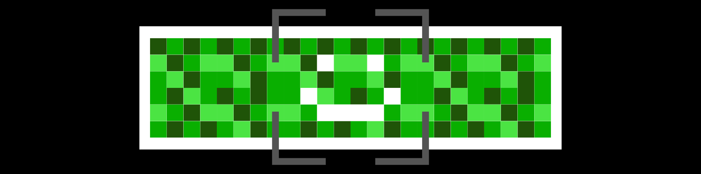

# Commit Wave




Commit Wave is a terminal app that fills a GitHub contribution graph and works towards three
GitHub achievement badges. It makes backdated commits across a date range, and it drives the
GitHub API to open and merge pull requests or to post and accept discussion answers until a
badge tier is met. It is built for learning and experiment, it writes to repositories you
own, and the disclaimer at the bottom of this file is worth reading before the first run.

## Setup

```bash
conda activate general
pip install -r requirements.txt
copy .env.example .env          # macOS and Linux: cp .env.example .env
```

Any Python 3.10 or newer works. Substitute your own environment name for `general`, or
use a virtual environment instead:

```bash
python -m venv .venv
.venv\Scripts\activate          # macOS and Linux: source .venv/bin/activate
pip install -r requirements.txt
```

Then open `.env` and fill in the values by hand. The Contribution Wave mode needs nothing
in `.env`; every Badge Farm mode needs `GITHUB_TOKEN`.

## Usage

```bash
python main.py
```

### The menu

```text
 ██████╗ ██████╗ ███╗   ███╗███╗   ███╗██╗████████╗    ██╗    ██╗ █████╗ ██╗   ██╗███████╗
██╔════╝██╔═══██╗████╗ ████║████╗ ████║██║╚══██╔══╝    ██║    ██║██╔══██╗██║   ██║██╔════╝
██║     ██║   ██║██╔████╔██║██╔████╔██║██║   ██║       ██║ █╗ ██║███████║██║   ██║█████╗
██║     ██║   ██║██║╚██╔╝██║██║╚██╔╝██║██║   ██║       ██║███╗██║██╔══██║╚██╗ ██╔╝██╔══╝
╚██████╗╚██████╔╝██║ ╚═╝ ██║██║ ╚═╝ ██║██║   ██║       ╚███╔███╔╝██║  ██║ ╚████╔╝ ███████╗
 ╚═════╝ ╚═════╝ ╚═╝     ╚═╝╚═╝     ╚═╝╚═╝   ╚═╝        ╚══╝╚══╝ ╚═╝  ╚═╝  ╚═══╝  ╚══════╝

Commit Wave: Hello. I am your commit bot.
Commit Wave: What would you like to do?
  1. Contribution Wave, backdated commits across a date range
  2. Badge Farm, work towards a GitHub achievement
  3. Status, what each badge stands at
  4. Quit
  > 1
Commit Wave: Please enter the start date (YYYY-MM-DD):
  > 2025-08-01
Commit Wave: Please enter the end date (YYYY-MM-DD):
  > 2025-08-02
Commit Wave: How many commits would you like to make?
  > 3
Commit Wave: Making 3 commits. This repository is the one that receives them.
  [3/3] Sat Aug 02 14:09:41 UTC 2025
Commit Wave: All commits are done and pushed to the remote.
```

Commits land in the repository you run the app from. Badge Farm writes to `GITHUB_REPO`
instead, or to the `origin` remote of this directory when that variable is unset.

### The badges

| Badge | Bronze, x2 | Silver, x3 | Gold, x4 | Unit | Accounts |
| :- | -: | -: | -: | :- | :- |
| Pull Shark | 16 | 128 | 1024 | Merged pull requests | One |
| Galaxy Brain | 8 | 16 | 32 | Accepted answers | Two |
| Pair Extraordinaire | 10 | 24 | 48 | Co-authored merged pull requests | Two |

Pick the badge, then the tier. Commit Wave reads how far along you already are, tells you how
many units are left and roughly how long they take, and asks you to type `yes` before it
writes anything.

```text
  > 2
Commit Wave: Which badge?
  1. Pull Shark           merged pull requests (Bronze 16, Silver 128, Gold 1024)
  2. Galaxy Brain         accepted answers (Bronze 8, Silver 16, Gold 32)
  3. Pair Extraordinaire  co-authored merged pull requests (Bronze 10, Silver 24, Gold 48)
  > 1
Commit Wave: One account is enough. Each unit opens a pull request and merges it.
Commit Wave: Which tier?
  1. x2 Bronze  16 merged pull requests
  2. x3 Silver  128 merged pull requests
  3. x4 Gold    1024 merged pull requests
  > 1
Commit Wave: You stand at 4 of 16. Reaching Pull Shark x2 Bronze means creating 12 more merged
             pull requests in rahfianugerah/commitwave, which takes about 8 minutes at the
             current request delay.
Commit Wave: This writes to that repository and cannot be undone in bulk. Type yes to continue.
  > yes
  [12/12] merged pull request #37
Commit Wave: Created 12 merged pull requests. GitHub awards achievements on its own schedule,
             so give your profile a day or two.
```

### When a setting is missing

Galaxy Brain and Pair Extraordinaire each need a second GitHub account. Commit Wave checks
before it starts and names what is absent, rather than failing partway through a run.

```text
  > 2
Commit Wave: Which badge?
  > 2
Commit Wave: Two GitHub accounts. The second account asks the question and marks your reply as
             the answer, because marking your own answer does not count.
Commit Wave: Which tier?
  > 1
Commit Wave: Galaxy Brain needs settings this project does not have yet.
  Missing in .env: GITHUB_TOKEN, SECONDARY_GITHUB_TOKEN
  Copy .env.example to .env and fill those names in.
  SECONDARY_GITHUB_TOKEN is a token from a different GitHub account.
```

### What each badge needs from you

- **Pull Shark.** One account. `GITHUB_TOKEN` needs the classic `public_repo` scope, or a
  fine-grained token scoped to the target repository with Contents and Pull requests set to
  read and write.
- **Pair Extraordinaire.** Two accounts, but only one token. Set `COAUTHOR_USERNAME` to the
  second account's login. Commit Wave reads that account's numeric id from the API and builds
  the `Co-authored-by` address itself, because a hand-typed address produces a commit that
  looks co-authored and counts for nothing.
- **Galaxy Brain.** Two accounts and two tokens, both needing Discussions write access. The
  second account asks the question and marks your reply as the answer. Marking your own
  answer does not earn the badge. Discussions must already be on for the repository, with an
  answerable question and answer category, because GitHub has no API to create one.

To change the question and answer text, edit `QA_TEMPLATES` in `commitwave/farm.py`. It ships
with placeholder text.

### Running on a schedule instead

Commit Wave is interactive, so it does not run itself. To keep a graph active without a
machine being on, this workflow does the same job from GitHub Actions. It is not installed
here. Copy it to `.github/workflows/commitwave.yml` if you want it, and set the two git
config values to your own.

```yaml
name: Commit Wave

on:
  schedule:
    - cron: '0 0 * * *'
  workflow_dispatch:

permissions:
  contents: write

jobs:
  commit:
    runs-on: ubuntu-latest
    steps:
      - uses: actions/checkout@v4

      - name: Set up git
        run: |
          git config user.name 'username'
          git config user.email 'youremail@email.com'

      - name: Pick a commit count
        id: random
        run: echo "count=$(shuf -i 1-2 -n 1)" >> "$GITHUB_OUTPUT"

      - name: Make commits
        run: |
          for ((i = 0; i < ${{ steps.random.outputs.count }}; i++)); do
            date >> commit.txt
            git add commit.txt
            git commit -m "chore: scheduled commit at $(date -u +%FT%TZ)"
          done
          git push
```

`cron: '0 0 * * *'` runs at midnight UTC daily. `cron: '0 */6 * * *'` runs every six hours.
GitHub delays scheduled workflows under load, so the times are approximate.

## Configuration

Every variable the app reads. Names only. Real values belong in `.env`, which is gitignored.

| Variable | Required | Description |
| :- | :- | :- |
| `GITHUB_TOKEN` | For Badge Farm | Token for the account that earns the badge |
| `GITHUB_REPO` | No | Target repository as `owner/name`. Defaults to the `origin` remote |
| `SECONDARY_GITHUB_TOKEN` | For Galaxy Brain | Token for the second account, which asks and accepts |
| `COAUTHOR_USERNAME` | For Pair Extraordinaire | Login of the second account named as co-author |
| `REQUEST_DELAY` | No | Seconds between GitHub write requests. Defaults to `8.0` |

`REQUEST_DELAY` is the calibration knob. GitHub allows roughly 500 content-generating
requests per hour, one pull request costs five of them, and those figures are described as
general rather than exact. Raise the delay if you see rate limit errors.

## Project Structure

```text
main.py                # entrypoint and menu
commitwave/
  config.py            # every setting, read once into a frozen object
  tui.py               # banner, typewriter output, prompts
  git.py               # git commands, run without a shell
  wave.py              # backdated commits across a date range
  github.py            # REST and GraphQL over urllib
  farm.py              # badge tiers, progress ledger, the three runners
tests/
data/                  # temp.txt, commit.txt, and progress.json live here
```

## Development

```bash
ruff check .          # lint
ruff format .         # format
pytest                # tests
```

The tests touch no network. They cover the date arithmetic and the badge tier logic, which
are the parts that can be wrong without an API call telling you.

## Known Limitations

- **Commit Wave cannot confirm a badge.** GitHub publishes no achievements API, in REST or in
  GraphQL. The app counts what it created and nothing more. Check your profile after a day or
  two.
- **Pair Extraordinaire has no live count.** GitHub has no co-author search qualifier, so that
  badge reads from `data/progress.json` alone. Delete that file and the count restarts at
  zero. Pull Shark and Galaxy Brain are read from GitHub itself and stay accurate.
- **Achievement rules are undocumented.** GitHub documents no thresholds and no eligibility
  rules; the numbers in the table above are community-maintained and could change without
  notice. Run the Bronze tier first and confirm the badge arrives before spending longer.
- **Gold Pull Shark is 1024 pull requests.** At the default delay that is roughly ten hours of
  continuous running. Interrupting it is safe, and rerunning carries on from the ledger.
- **A rate limit stops the run.** Commit Wave honours GitHub's backoff headers and retries
  five times, then stops with the reason. Continuing to call a limited endpoint can get an
  account banned, so it does not push past that.
- **The wave mode commits to the current repository only.** It has no target option, and it
  pushes once at the end using whatever git credentials the machine already has.

## Disclaimer

Commit Wave automates activity that GitHub's achievement system is meant to measure. It is
published for education and experiment. Use it on repositories you own, and do not use it to
misrepresent project progress or to inflate activity somewhere it will mislead people.

GitHub staff have publicly described coordinated badge farming, self-marked answers in
particular, as inauthentic activity, and disabled achievements in GitHub Community
Discussions in 2024 because of it. That is a real posture even where the enforcement is
undocumented. Keep this in one repository of your own and understand that the risk of using
it is yours.

## License

MIT. See [LICENSE](LICENSE).

Author: [@rahfianugerah](https://github.com/rahfianugerah)
